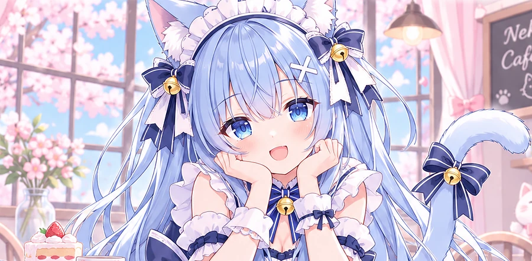
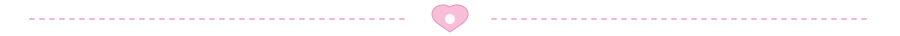
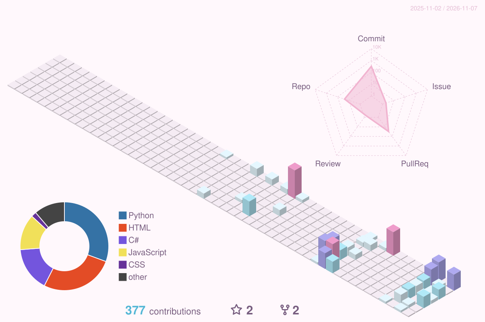

### ♡ My Contributions

### ♡ Contribution Snake

<picture>
  <source media="(prefers-color-scheme: dark)" srcset="https://raw.githubusercontent.com/lovesky514514-cmd/lovesky514514-cmd/output/sukoya-snake-dark.svg" />
  <source media="(prefers-color-scheme: light)" srcset="https://raw.githubusercontent.com/lovesky514514-cmd/lovesky514514-cmd/output/sukoya-snake.svg" />
  
</picture>

